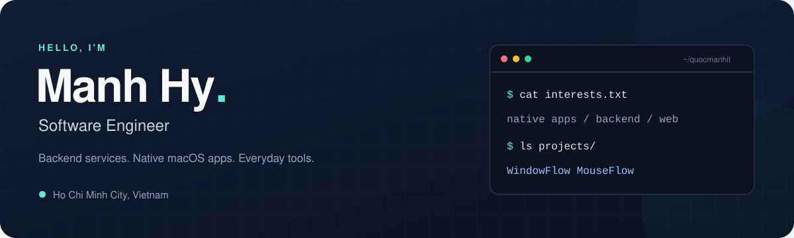

  

  <a href="https://github.com/quocmanhit?tab=repositories">Explore my projects</a>
  &nbsp; · &nbsp;
  <a href="https://github.com/quocmanhit/window-flow/releases/latest">Try WindowFlow</a>
  &nbsp; · &nbsp;
  <a href="https://github.com/quocmanhit/mouse-flow/releases/latest">Try MouseFlow</a>

### A little about me

Hi, I'm **Manh Hy** — a software engineer based in **Ho Chi Minh City, Vietnam**.

I build backend services, web applications, and native macOS utilities. My public projects range from NestJS and Laravel examples to tools that make switching windows and using a mouse feel better on a Mac.

- **Native apps:** lightweight Swift utilities that live in the macOS menu bar.
- **Backend & web:** TypeScript with NestJS, and PHP with Laravel, Filament, and Livewire.
- **Open source:** explore the code, try an app, or open an issue with feedback.

### Featured projects

<table>
  <tr>
    <td valign="top" width="50%">
      <h3><a href="https://github.com/quocmanhit/window-flow">WindowFlow ↗</a></h3>
      
<strong>A smoother way to move between windows.</strong>

      
Windows-style Alt-Tab and keyboard window management for macOS, packed into a lightweight menu bar app.

      
Window switching across Spaces · Custom shortcuts · Window layouts

      
<code>Swift</code> <code>macOS</code>

      <a href="https://github.com/quocmanhit/window-flow">Source code</a> &nbsp; · &nbsp;
      <a href="https://github.com/quocmanhit/window-flow/releases/latest">Download</a>
    </td>
    <td valign="top" width="50%">
      <h3><a href="https://github.com/quocmanhit/mouse-flow">MouseFlow ↗</a></h3>
      
<strong>Make your mouse feel at home on a Mac.</strong>

      
Smooth wheel scrolling, independent mouse scroll direction, and per-app button mapping in a native menu bar app.

      
Smooth scrolling · Custom button actions · Per-app settings

      
<code>Swift</code> <code>macOS</code>

      <a href="https://github.com/quocmanhit/mouse-flow">Source code</a> &nbsp; · &nbsp;
      <a href="https://github.com/quocmanhit/mouse-flow/releases/latest">Download</a>
    </td>
  </tr>
</table>

### Technologies in my projects

  
  
  
  
  
  
  

### More to explore

| Project | What you'll find |
| :--- | :--- |
| [nestjs-project-sample](https://github.com/quocmanhit/nestjs-project-sample) | A TypeScript backend sample with NestJS, TypeORM, PostgreSQL, and Swagger. |
| [simple-laravel-filament](https://github.com/quocmanhit/simple-laravel-filament) | A Laravel project with Filament. |
| [simple-laravel-livewire](https://github.com/quocmanhit/simple-laravel-livewire) | A Laravel project with Livewire. |

---

  Thanks for stopping by. Found something useful? A star or an issue is always welcome.

