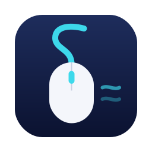

<picture>
  <source media="(prefers-color-scheme: dark)" srcset="assets/intro-dark.svg">
  
</picture>

### About me

My work centers on **backend services and APIs**, using **Go** and **Node.js / TypeScript**. I also build web interfaces with **React** and native macOS utilities with **Swift**.

My projects involve HTTP APIs, database access, caching, and messaging between services, as well as the interfaces people use to work with them.

### Tech stack

| Area | Technologies |
| :--- | :--- |
| Backend | Go · Node.js · TypeScript · Echo · GORM · Moleculer |
| Data & messaging | PostgreSQL · MongoDB · Redis · NATS |
| Frontend | React |
| Native apps | Swift · macOS |

### Selected projects

<table>
  <tr>
    <td width="50%" align="center" valign="top">
       
      
      <h3><a href="https://github.com/quocmanhit/window-flow">WindowFlow ↗</a></h3>
      
Windows-style Alt-Tab, customizable keyboard shortcuts, and window layouts in a lightweight macOS menu bar app.

      Swift · macOS
        
    </td>
    <td width="50%" align="center" valign="top">
       
      
      <h3><a href="https://github.com/quocmanhit/mouse-flow">MouseFlow ↗</a></h3>
      
Smooth mouse-wheel scrolling, independent scroll direction, and per-app button mappings in a lightweight macOS menu bar app.

      Swift · macOS
        
    </td>
  </tr>
</table>
