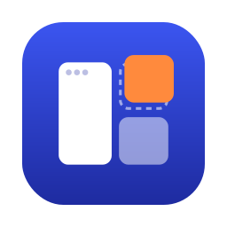
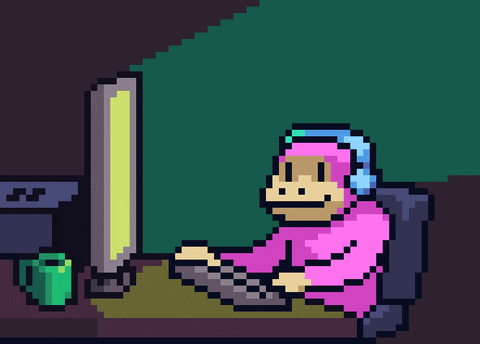

  

### A little about me

👋 I’m **Manh Hy**, a software engineer based in **Ho Chi Minh City, Vietnam**. My work centers on **backend services and APIs**, using **Go** and **Node.js / TypeScript**.

⚙️ I work with **databases, caching, and messaging between services**—connecting HTTP APIs with the data and workflows behind them. **Echo, GORM, and Moleculer** are part of my backend toolkit.

🛠️ I also build **React** interfaces, **Python** AI services, and native macOS utilities with **Swift**.

### Building with AI

🤖 I apply AI to **news workflows and language learning**, building the services and interfaces around each feature.

- **AI News:** article summaries, key takeaways, and article-based Q&A; text and audio digests for Telegram; and structured video-script drafts from selected stories.
- **My English:** contextual translation, feedback on learner-written sentences, targeted review cards for difficult vocabulary, and pipelines that turn video transcripts into vocabulary for study.
- **Product engineering:** structured outputs, validation, caching, and provider fallbacks; application rules map model feedback to review ratings.
- **Development workflow:** **Claude Code and Codex**, reusable skills and MCP integrations from my **dotfiles**, scoped tasks, independent reviews, and checks on integrated changes.

### Technical stacks

  <strong>Languages &amp; runtime</strong> 
  
  
  
  
  

  <strong>Frameworks &amp; libraries</strong> 
  
  
  
  

  <strong>Databases, cache &amp; messaging</strong> 
  
  
  
  

### Selected projects

<table>
  <tr>
    <td width="50%" align="center" valign="top">
      
      
<strong><a href="https://github.com/quocmanhit/window-flow">WindowFlow ↗</a></strong>

      
Alt-Tab window switching, keyboard shortcuts, and window layouts for macOS.

      Swift · macOS
    </td>
    <td width="50%" align="center" valign="top">
      
      
<strong><a href="https://github.com/quocmanhit/mouse-flow">MouseFlow ↗</a></strong>

      
Smooth scrolling, independent scroll direction, and per-app mouse button mappings.

      Swift · macOS
    </td>
  </tr>
</table>

  <picture>
    <source media="(prefers-reduced-motion: reduce)" srcset="assets/monkey-still.jpg">
    
  </picture>

